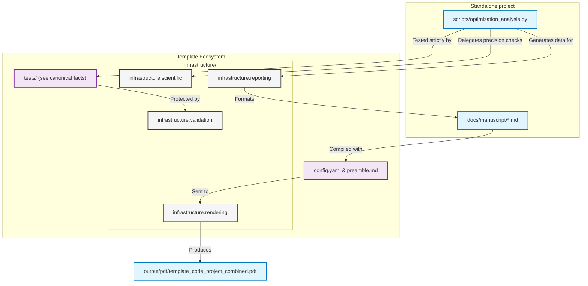

# `template_code_project` - The Repository Exemplar

This is the stable code exemplar for the Research Project Template: a tested numerical optimization implementation routed through the shared infrastructure, project test suite, and manuscript renderer.

It demonstrates the complete research pipeline from algorithm implementation through strict validation to multi-format result visualization.

## Template Architecture

This project is explicitly designed to showcase the repository's three foundational pillars:

1. **`infrastructure/` Layer**: The optimizer delegates tracking and scientific checks to shared Template infrastructure. The pinned Template checkout runs the render and validation stages. Follow the [quick start](../quickstart.md). Current package counts live in [`docs/_generated/COUNTS.md`](https://github.com/docxology/template/blob/87704feae0a4490ef7dad9c931d268e8c30273c2/docs/_generated/COUNTS.md).
2. **`tests/` Integrity**: A zero-mock suite ([`tests/`](../../tests/)) with **≥90%** coverage on `src/`. Live test count and measured coverage: [`docs/_generated/COUNTS.md`](https://github.com/docxology/template/blob/87704feae0a4490ef7dad9c931d268e8c30273c2/docs/_generated/COUNTS.md).
3. **`docs/` Orchestration**: The [standalone documentation](../README.md) describes setup, rendering, and output locations.

## Manuscript Structure

The numbered Markdown sections in `docs/manuscript/` describe the optimizer and its experiments. Template hydrates the analysis tokens and renders the configured editions.

- `00_abstract.md`: Abstract; build variables and CSV-backed prose via `scripts/z_generate_manuscript_variables.py`.
- `01_introduction.md`: Introduction of the infrastructure pillars bridging to CI/CD files.
- `02_methodology.md`: Mathematical methods mapping to specific python script execution lines.
- `03_results.md`: Convergence analysis built via `infrastructure.reporting`, pointing back at itself.
- `04_conclusion.md`: Summary of the template automation and publication outputs.

## Architecture

The project acts as a bridge between custom mathematical logic and the repository's core:



## Render and validate

Follow the [quick start](../quickstart.md) to generate the figures and
results, hydrate the numbered source sections, and invoke Stages 03 and 04
from the pinned template checkout.

## Bibliography

Edit [`references.bib`](references.bib) to add sources. Markdown citations use
`[@key]`. Pandoc resolves them against the bibliography when rendering the
publication. Validate the bibliography from the project root with the
template environment set up in the quick start.

```bash
uv run python -m infrastructure.reference.citation.cli validate \
  docs/manuscript/references.bib --strict
```

## AI Agent Directives

If you are an AI agent operating in this repository, you **MUST** read [`AGENTS.md`](AGENTS.md) before executing any code modifications. It defines the zero-mock testing constraints and infrastructure coupling rules.

## See also

- [`SYNTAX.md`](SYNTAX.md) — Pandoc citation / cross-reference conventions for this manuscript.
- [Manuscript semantics](https://github.com/docxology/template/blob/87704feae0a4490ef7dad9c931d268e8c30273c2/docs/guides/manuscript-semantics.md) — Repository-wide manuscript semantics.
- [Public exemplar roster](https://github.com/docxology/template/blob/87704feae0a4490ef7dad9c931d268e8c30273c2/AGENTS.md#permanent-canonical-exemplars) — public exemplar roster.
